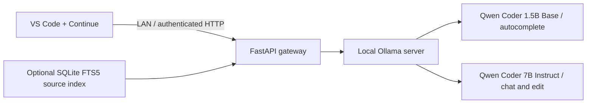

# Local Code Assistance Tool

A self-hosted coding assistant for offline networks. VS Code clients use Continue
and send requests to a shared GPU server running Ollama behind a small FastAPI gateway.
The default profile targets C++14 development and common Qt, GStreamer, network,
serial communication, and ACE patterns.

This repository contains application source, synthetic examples, tests, and setup
instructions. Model weights, editor extension packages, generated client settings,
request captures, and deployment credentials are not distributed in the repository.
The example environment intentionally contains no access keys; generate private settings
before starting the service.

## Architecture



## Features

- Streaming chat and fill-in-the-middle (FIM) code completion.
- Per-user generated access keys and an explicit model/API allowlist.
- Bounded inference concurrency and queues, with disconnect cleanup.
- Independent chat and completion context budgets.
- Optional CPU-based source retrieval with file and line references.
- A browser request monitor with operator-only REST and SSE endpoints.
- Offline deployment using pre-downloaded models, container images, and a Continue VSIX.

| Role | Default model | Context | Maximum output |
|---|---|---:|---:|
| Chat / edit | `qwen2.5-coder:7b-instruct-q4_K_M` | 4096 | 1024 |
| FIM | `qwen2.5-coder:1.5b-base` | 8192 | 256 |

The Continue FIM prompt budget is 4096 tokens. The gateway overrides client context
settings with server policy. Context, model memory, and active requests must be sized
together; the default three-request limit is not a capacity guarantee.

## Requirements

For the desktop GPU setup:

- Linux, Python 3.11+, and Docker Compose.
- Docker 28.3+ with CDI support and a compatible NVIDIA driver.
- NVIDIA Container Toolkit with `nvidia.com/gpu=all` visible to CDI.
- Enough GPU memory for both models, context caches, and runtime buffers.
- VS Code and a matching Continue extension package on each client.

ARM64/Jetson deployment requires compatible images and a JetPack-specific GPU setup.
Desktop images cannot be copied unchanged to an ARM64 server.

## Quick start

Clone this repository and run the preparation script while internet is available:

```bash
bash scripts/prepare.sh
```

This creates a local Python environment, installs pinned dependencies, generates
private settings, downloads the two models, and starts the gateway. Existing `.env`
and generated client settings are preserved.

The initial API address is `http://127.0.0.1:8080`. Generated settings are stored in
`clients/developer/config.yaml`; copy the appropriate model definitions to the active
Continue configuration. Do not publish this file or `.env`.

Install an appropriate Continue VSIX, turn off **Allow Anonymous Telemetry** in
Continue User Settings, then run **Developer: Reload Window** in VS Code. Select
**Local C++14 Chat** for chat and **Local FIM Completion** for autocomplete. Agent/tool
calling is not implemented by this gateway.

For LAN client setup, use the [client guide](docs/client-lan.md). To start with the
isolated Ollama network and locally available images:

```bash
docker compose -f compose.yaml -f compose.offline.yaml up -d --no-build --pull never
```

The offline overlay isolates Ollama. It does not apply a general internet firewall
to the host, gateway, or VS Code. See the [offline guide](docs/offline.md).

## Code completion

Enable `continue.enableTabAutocomplete` and `editor.inlineSuggest.enabled`. Test in
a saved C++ file with the cursor after `return `:

```cpp
int add(int a, int b) {
    return
}
```

Use **Continue: Force Autocomplete** from the command palette, or `Ctrl+Alt+Space`
on Linux. Accept a visible suggestion with Tab. See [FIM configuration and
troubleshooting](docs/fim.md). Central repository retrieval is currently used by chat,
not by autocomplete.

## Optional source retrieval

Index an explicitly selected source tree:

```bash
.venv/bin/codeassist-index build examples/embedded --output data/context/context.sqlite
.venv/bin/codeassist-index search 'SerialFrameDecoder hasCompleteFrame' \
  --index data/context/context.sqlite
```

The default gateway mount exposes this database at `/context/context.sqlite`.
If `CONTEXT_INDEX_PATH` was changed, set it to the intended database and recreate the
gateway. Index replacement is atomic; an updated database is read on the next query.

This is lexical retrieval, not a compiler index or full-project understanding. The
prototype skips hidden paths, symlinks, selected generated/build/vendor paths, and files
over 512 KB. It does not yet cover extensionless Makefiles or all build-file extensions.
The source tree's `.codeassistignore` supplies additional glob exclusions. These filters
are not a secret scanner. All API users of one service share the same source index.

For large projects and build variants, see the [indexing design](docs/large-cpp-index.md)
and [code analysis design](docs/code-analysis.md). Compiler-based analysis and variant
selection are planned; they are not implemented features.

## API and request monitor

| Endpoint | Purpose | Access |
|---|---|---|
| `GET /health/live` | Process liveness | Public |
| `GET /health/ready` | Backend/model readiness | Authenticated |
| `POST /api/chat` | Chat/edit requests | Authenticated |
| `POST /api/generate` | Completion requests | Authenticated |
| `GET /api/tags`, `POST /api/show` | Enabled model metadata | Authenticated |
| `GET /v1/context/search` | Source retrieval | Authenticated |
| `GET /metrics` | JSON inference counters | Authenticated |
| `GET /monitor` | Browser monitor shell | Public shell; operator-only data |

The [monitor guide](docs/monitor.md) documents the operator REST/SSE API. Trace text is
kept in bounded RAM storage and is not persisted. Request bodies may contain source
code, so operator access must be restricted. A sent response does not prove that the
editor displayed or accepted it.

## Development and validation

```bash
python3 -m venv .venv
.venv/bin/python -m pip install -r requirements.lock
.venv/bin/python -m pip install -e '.[dev]'
.venv/bin/pytest -q
.venv/bin/ruff check codeassist scripts tests
```

Optional live checks use generated private credentials:

```bash
.venv/bin/python scripts/smoke.py
.venv/bin/python scripts/benchmark.py --rounds 10 --output artifacts/benchmark.json
.venv/bin/python scripts/check-fim.py --output artifacts/fim-validation.json
```

Tests use synthetic inputs. Short, repeated benchmark prompts are not representative
of a large repository or sustained multi-user autocomplete. See [validation scope](docs/validation.md).

## Deployment boundaries

The prototype uses one Uvicorn worker, three active inference slots, and fifteen queued
requests. Per-user fairness, central FIM retrieval, incremental source indexing, compiler
analysis jobs, and branch/build identity matching remain future work. Model suggestions
must be checked with the actual target toolchain and relevant tests.

For shared deployments, provide LAN-restricted access and HTTPS through a streaming-aware
reverse proxy. Distribute only each user's generated configuration. Keep private runtime
files and source snapshots outside Git. The repository's ignore rules exclude these files,
but any public release should also receive a content and secret scan.

[Deployment roadmap](docs/plan.md) · [Offline distribution](docs/offline.md)

## Third-party components

[Ollama](https://github.com/ollama/ollama), [Continue](https://github.com/continuedev/continue),
[Qwen](https://huggingface.co/Qwen), and the Python dependencies are separate projects.
Their licenses and redistribution conditions apply to their respective components;
their binaries and model weights are not included in this source repository.
